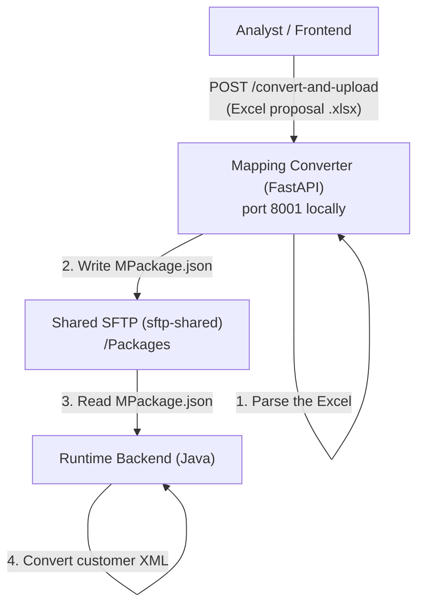

# H.Essers — Mapping Converter

**Goal:** Take a mapping proposal that an analyst has reviewed and carry it through the rest of the design-time flow: from **approving** the proposal up to storing the **JSON mapping package** on the SFTP server. The package contains the exact `source_path` / `target_path` pairs the Runtime Backend (Java) uses to convert incoming customer XML into the standardized H.Essers schemas.

This service does **not** generate proposals (that is `Mapping_Proposal`) and does **not** convert customer messages at runtime (that is `Runtime`).

## What happens when you approve a proposal?

1. **The analyst clicks "Goedkeuren"** in the frontend and fills in a short description of the change ("Eerste versie voor <klant>" is suggested for v1).
2. **The frontend calls `POST /approve`** on this service (through `/api/converter/*`).
3. **The converter checks the proposal** on the shared SFTP server (`sftp-shared`): it must exist and be in review (`READY_FOR_REVIEW`, `IN_REVIEW` or `In review`).
4. **The converter updates the metadata** of that version: status `AI_CHECKING_REVIEW` ("AI-controle bezig"), the description and the approval time.
5. **The AI review starts.** It picks up proposals with status `AI_CHECKING_REVIEW` (separate story). While it runs, the proposal cannot be approved again.

## What happens when you convert a proposal?



1. **Input:** an approved mapping proposal workbook (`.xlsx`, the standard template that Mapping_Proposal writes).
2. **Extraction** (`services/excel_converter.py`): reads the `Mapping Proposal` sheet (or the first sheet named like it) and takes per row:
   - **Source path:** `Source full path`, or `Source segment path` + `Source field name`.
   - **Target path:** `Target full path`, or `Target segment path` + `Target field name`.
   Rows without a target path are skipped.
3. **Metadata** (`services/packages.py`): adds `schema_version` and a `meta` header (client name, package version, proposal type, UTC creation date, author).
4. **Storage:** writes `MPackage.json` atomically to `/Packages/<company>/<version>/<proposal_type>/`.

Linking this automatically to the approval (package only after a successful AI review) is a later story.

## Project folders

```text
Mapping_Converter/
├── api.py                  HTTP API (FastAPI): creates the app and registers routers/
├── requirements.txt        Python packages to install
├── pyproject.toml          pytest and ruff settings
├── Dockerfile              Container image (python:3.12-slim, port 8000)
├── routers/                HTTP endpoints, one file per resource (thin: they call services/)
│   ├── approve.py          POST /approve – approve a reviewed proposal
│   └── convert.py          POST /convert and /convert-and-upload – Excel proposal -> JSON package
├── services/               Business logic
│   ├── approval.py         Validation and status update when a proposal is approved
│   ├── excel_converter.py  Parse an Excel mapping proposal into a MappingPackage
│   ├── packages.py         Name, add metadata to and store MPackage.json
│   ├── proposal_files.py   Find a proposal version and read/write its metadata (reuse this in new steps)
│   ├── statuses.py         ProposalStatus enum and the statuses that may be approved
│   └── storage.py          Connection to the shared SFTP server (or a local stand-in folder)
├── scripts/                Shared basics
│   ├── config.py           Settings from the shared .env in the repo root (read in one place)
│   ├── errors.py           Clear error types (StorageError, ProposalNotFoundError, ...)
│   ├── models.py           Pydantic models: MappingEntry, PackageMeta, MappingPackage, responses
│   └── safe_files.py       Safe paths and atomic file writes
└── tests/
    ├── conftest.py         Shared fixtures (a temporary proposals folder)
    ├── api/                Endpoint tests with FastAPI's TestClient
    └── unit/               Tests for services/ and scripts/
```

`services/storage.py`, `scripts/errors.py` and `scripts/safe_files.py` are **copied on purpose** from `Mapping_Proposal`, so both services can be built and deployed independently. Keep them identical when you fix something in one of them.

## First-time setup (Windows / VS Code)

1. Open the **`Mapping_Converter` folder** in a PowerShell terminal.
2. Make sure Python 3.12 or later is installed.
3. Create a virtual environment and install the dependencies:

   ```powershell
   python -m venv .venv
   .\.venv\Scripts\Activate.ps1
   python -m pip install -r requirements.txt
   ```

4. Install the shared CI tools (pytest, pytest-cov, ruff) used by the pipeline:

   ```powershell
   python -m pip install -r ..\.github\requirements\python-ci.txt
   ```

## Configuration

This service reads **one shared `.env` in the repository root** (`Essers_Mapping/.env`), created from `.env.example`:

```powershell
Copy-Item ..\.env.example ..\.env
```

Variables that are already set in the terminal or in Kubernetes always win over the `.env` file.

| Variable | Meaning | Local value |
|---|---|---|
| `SFTP_SHARED_HOST` | Shared SFTP server; empty = use the local folder `data/sftp-shared/` | `localhost` |
| `SFTP_SHARED_PORT` | SFTP port | `2222` |
| `SFTP_SHARED_USER` | SFTP user | `shareduser` |
| `SFTP_SHARED_PASSWORD` | SFTP password | `devpassword` |
| `SFTP_SHARED_PROPOSALS_DIR` | Folder with the proposals | `/Proposals` |
| `SFTP_SHARED_PACKAGES_DIR` | Folder for the mapping packages | `/Packages` |
| `CORS_ORIGINS` | Only when a browser calls this API directly | `http://localhost:5173` |

**Never commit `.env`.** It is ignored by Git.

## API

| Endpoint | Returns |
|---|---|
| `GET /health` | `{"status": "ok", "service": "mapping-converter"}` |
| `GET /` | `{"message": "Mapping Converter Service"}` |
| `POST /approve` | approves a reviewed proposal and starts the AI review |
| `POST /convert` | **preview:** converts an Excel proposal to the JSON package, nothing is stored |
| `POST /convert-and-upload` | converts an Excel proposal and stores `MPackage.json` on SFTP (`/convert/save` is a hidden alias) |

### POST /approve

```http
POST /approve?company=voorbeeldbedrijf-b&version=v2&proposalType=outbound
Content-Type: application/json

{"description": "Leverdatum mapt nu op DeliveryDate in plaats van OrderDate"}
```

| Parameter | Rules |
|---|---|
| `company` (query) | Required, max. 20 characters, case-insensitive |
| `version` (query) | Required, format `v<number>` (e.g. `v1`) |
| `proposalType` (query) | Required, max. 20 characters, case-insensitive (e.g. `inbound`) |
| `description` (body) | Required, not only spaces, max. 200 characters (trimmed) |

Response `200 OK`:

```json
{
  "company": "voorbeeldbedrijf-b",
  "version": "v2",
  "proposal_type": "outbound",
  "status": "AI_CHECKING_REVIEW",
  "approval_description": "Leverdatum mapt nu op DeliveryDate in plaats van OrderDate",
  "approved_at": "2026-11-20T10:00:00+00:00"
}
```

| Status | When |
|---|---|
| `200 OK` | Approved; status is now `AI_CHECKING_REVIEW` |
| `400 Bad Request` | Empty or too long description, invalid or missing parameter |
| `404 Not Found` | Customer, version, proposal type or metadata file does not exist |
| `409 Conflict` | The AI review is already running, or the status does not allow approving |
| `502 Bad Gateway` | The shared SFTP server cannot be reached |

Errors return `{"detail": "<Dutch message>"}`; the frontend shows that message as is.

### POST /convert and POST /convert-and-upload

Both take `multipart/form-data` with the workbook in `file` (`.xlsx` or `.xls`). `/convert` only returns the package; `/convert-and-upload` also needs:

| Form field | Rules |
|---|---|
| `company` | Required, e.g. `nouryon` (normalized to a lowercase slug) |
| `version` | Required, e.g. `v4`, `4` or `1.0.0` (folder normalized to `v<N>`) |
| `proposal_type` | Required, e.g. `inbound` or `outbound` (lowercase slug) |
| `user_created` | Optional, default `analist_a` |
| `package_version` | Optional semantic version; default `<N>.0.0` from `version` |

| Status | When |
|---|---|
| `200 OK` / `201 Created` | `/convert` returns the package / `/convert-and-upload` stored it |
| `400 Bad Request` | Not an Excel file, empty file, workbook cannot be read, or a missing form field |
| `502 Bad Gateway` | The shared SFTP server cannot be reached |

Example package (`MPackage.json`):

```json
{
  "schema_version": "1.0",
  "meta": {
    "client_name": "nouryon",
    "package_version": "1.0.0",
    "package_type": "inbound",
    "date_created": "2026-11-20T12:00:00Z",
    "user_created": "analist_a"
  },
  "mappings": [
    {
      "source_path": "/DELVRY03/IDOC/E1EDL20/VBELN",
      "target_path": "/SHP_OBDLV_SAVE_REPLICA05/IDOC/E1BPOBDLVHDR/DELIV_NUMB"
    }
  ]
}
```

Response of `/convert-and-upload` (`201`):

```json
{
  "status": "success",
  "sftp_path": "/Packages/nouryon/v4/outbound/MPackage.json",
  "sftp_server": "localhost:2222",
  "company": "nouryon",
  "version": "v4",
  "proposal_type": "outbound",
  "filename": "MPackage.json",
  "mapping_count": 1,
  "package": { "...": "the package above" }
}
```

Examples with curl (from `Mapping_Converter/`):

```bash
# Preview only
curl -X POST "http://localhost:8001/convert" -F "file=@../Mapping_Proposal/templates/mapping_template.xlsx"

# Convert and store on SFTP
curl -X POST "http://localhost:8001/convert-and-upload" \
  -F "file=@../Mapping_Proposal/templates/mapping_template.xlsx" \
  -F "company=nouryon" -F "version=v4" -F "proposal_type=outbound" -F "user_created=analist_a"
```

From Python:

```python
from services.packages import convert_excel_to_package
from services.storage import packages_storage

package, sftp_path = convert_excel_to_package(
    packages_storage(), "proposal.xlsx", company="nouryon", version="v4", proposal_type="outbound",
)
```

### Where the data lives

The proposals are stored on `sftp-shared`, with the same layout `Mapping_Proposal` and `Version_Control` use:

```text
<SFTP_SHARED_PROPOSALS_DIR>/<customer>/v<N>/<proposal-type>/
    metadata.json  or  proposal.json   metadata (metadata.json wins, like in Version_Control)
    MProposal-<Klant>_V<N>.xlsx         the proposal
```

Approving adds these fields to the metadata and keeps all other fields:

```json
{
  "status": "AI_CHECKING_REVIEW",
  "approval_description": "Eerste versie voor Nouryon",
  "approved_at": "2026-11-20T10:00:00+00:00",
  "updated_at": "2026-11-20T10:00:00+00:00"
}
```

The description cannot be changed afterwards: there is no endpoint for it, and a proposal in `AI_CHECKING_REVIEW` cannot be approved again.

The mapping packages are stored next to them, under `SFTP_SHARED_PACKAGES_DIR`:

```text
/Packages/<company>/v<N>/<proposal_type>/MPackage.json     e.g. /Packages/nouryon/v4/outbound/MPackage.json
```

Company and proposal type are lowercase slugs (`"Nouryon "` -> `nouryon`), versions are normalized to `v<N>` (`"4"`, `"V4"` -> `v4`).

## Run locally

1. Start the SFTP servers (from the repo root):

   ```powershell
   docker compose -f Scripts/docker-compose.sftp.yml up -d
   ```

2. Fill them with example proposals (from `Mapping_Proposal/`):

   ```powershell
   python -m scripts.dev_seed
   ```

3. Start this service (from `Mapping_Converter/`). Locally it runs on **port 8001**, because Mapping_Proposal already uses 8000:

   ```powershell
   uvicorn api:app --reload --port 8001
   ```

Open http://localhost:8001/docs to try the endpoints. Good test cases from the seed data:

| company | version | proposalType | Expected |
|---|---|---|---|
| `voorbeeldbedrijf-b` | `v2` | `outbound` | `200` |
| `voorbeeldbedrijf-e` | `v1` | `outbound` | `200` |
| `voorbeeldbedrijf-c` | `v1` | `inboud-accept` | `409` (AI review already running) |
| `voorbeeldbedrijf-a` | `v1` | `inbound` | `409` (AI still generating) |

The Vite dev server of the frontend proxies `/api/converter/*` to `http://localhost:8001`.

## Tests

From `Mapping_Converter/`:

```powershell
python -m pytest --cov=services --cov=scripts --cov=routers
python -m ruff check .
```

The tests never use the real SFTP server: they use a temporary folder or a fake SFTP client.

- `tests/api/`: endpoint tests (`/approve`, `/`, `/convert`, `/convert-and-upload`, validation and errors).
- `tests/unit/`: approval, proposal files and statuses, Excel parsing, package naming/storage, config and storage.

Some Excel tests use the real example `data/shared-sftp/Proposals/nouryon/v4/MProposal-Nouryon_V4.xlsx` in the repo root and are skipped when it is not there. The project norm is **at least 70% coverage**. To run the tests of all projects at once, use `.\Scripts\run-tests.cmd` from the repo root.

## Kubernetes

The service runs as the `mapping-converter` deployment (`Kubernetes/base/preparation/mapping-converter.yaml`), listens on port 8000 and is only reachable through the frontend, which proxies `/api/converter/*`. The SFTP settings come from the `common-config` ConfigMap and the `sftp-shared-credentials` Secret. A NetworkPolicy allows access to `sftp-shared` and blocks `sftp-runtime`.
