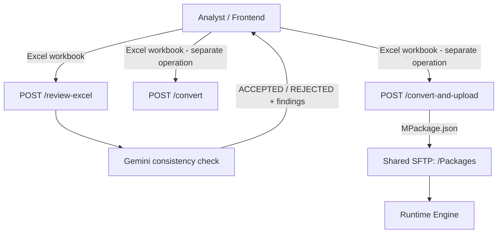

# Mapping Converter Service

The **Mapping Converter Service** is a FastAPI microservice in the H. Essers Mapping Platform. It provides two currently independent capabilities:

1. **Gemini Excel consistency review** — examines a mapping proposal workbook for internal contradictions and returns an `ACCEPTED` or `REJECTED` decision with findings.
2. **Excel-to-JSON conversion** — converts an approved mapping proposal into a structured `MPackage.json`, optionally uploading it to shared SFTP storage for the Runtime Engine.

> **Important:** These are separate API operations. At present, `/convert` and `/convert-and-upload` **do not automatically invoke** `/review-excel` or verify a prior AI acceptance. The approval gate must be integrated into the full workflow before relying on it to prevent publication of rejected workbooks.

## Architecture



### Main files

| File | Responsibility |
| --- | --- |
| `api.py` | FastAPI endpoints, upload validation, and HTTP responses |
| `scripts/pipeline.py` | Coordinates Excel extraction and Gemini review |
| `scripts/excel_review.py` | Extracts mapping fields from uploaded `.xlsx` workbooks |
| `scripts/gemini_review.py` | Calls Gemini and interprets its structured response |
| `scripts/config.py` | Loads review settings from the repository-root `.env` or environment |
| `review_prompt.txt` | Gemini review instructions and decision guidance |
| `converter.py` | Parses mapping workbooks into JSON mapping packages |
| `models.py` | Mapping package and API response models |
| `sftp_service.py` | SFTP configuration, directory handling, and package upload |
| `tests/` | API, Excel review, converter, architecture, and SFTP-related tests |

## API endpoints

| Method | Endpoint | Purpose |
| --- | --- | --- |
| `GET` | `/health` | Service health check |
| `GET` | `/` | Service identifier |
| `POST` | `/review-excel` | Gemini consistency review; does not upload a package |
| `POST` | `/convert` | Convert an Excel mapping proposal to JSON without uploading |
| `POST` | `/convert-and-upload` | Convert Excel to JSON and upload `MPackage.json` to SFTP |
| `POST` | `/convert/save` | Alias for `/convert-and-upload`; hidden from Swagger |

Swagger documentation: <http://localhost:8001/docs>

### Gemini consistency review: `POST /review-excel`

Takes query parameters `companyName`, `type`, and `versionNumber` (e.g. `?companyName=nouryon&type=inbound&versionNumber=v2`) and does not require any request body. The service retrieves the proposal `.xlsx` workbook directly from the SFTP server (from `/Proposals/<companyName>/<versionNumber>/<type>/` or fallback to `/Proposals/<companyName>/<versionNumber>/`), extracts mapping details from the **Mapping Proposal** worksheet, and asks Gemini to assess internal consistency, including suspicious duplicate target fields, conflicting source mappings, and obvious rule contradictions. Conditional or otherwise justified mappings need not be rejected.

All three parameters are required:
- `companyName`: Name or slug of the company/client (e.g., `nouryon`).
- `type`: Proposal type (e.g., `inbound` or `outbound`).
- `versionNumber`: Version identifier or number (e.g., `v2` or `2`).

A successful request returns HTTP `200` with a result such as:

```json
{
  "decision": "REJECTED",
  "summary": "Conflicting target mappings were detected.",
  "findings": [
    "Two unconditional mappings target the same CITY field with different source paths."
  ],
  "checked_mappings": 96
}
```

The example above is illustrative. `findings` are currently strings, not structured objects with separate mapping/problem/suggestion properties.

- `decision: "ACCEPTED"` means the workbook passed Gemini's consistency review, **not** that business mapping correctness was independently verified.
- `decision: "REJECTED"` indicates Gemini found actionable inconsistencies.
- HTTP `400` means invalid or empty query parameters; `404` means the workbook was not found on SFTP; `422` means missing required query parameters or an invalid/corrupted workbook; `502` means an SFTP connection or transfer error; `503` means the AI review is temporarily unavailable. **None of these error responses is an acceptance.**

Example:

```bash
curl -X POST "http://localhost:8001/review-excel?companyName=nouryon&type=inbound&versionNumber=v2"
```

### Excel-to-JSON preview: `POST /convert`

Accepts multipart form field `file` and returns a JSON mapping package without writing to SFTP. It reads source/target paths from the workbook according to the conversion implementation:

- Source path: `Source full path`, with supported fallbacks to source segment and field columns.
- Target path: the target segment path combined with the target field name.

```bash
curl -F "file=@mapping_package.xlsx" http://localhost:8001/convert
```

### Convert and upload: `POST /convert-and-upload`

Accepts a multipart upload and writes a JSON mapping package to the shared SFTP server.

| Form field | Required | Meaning |
| --- | --- | --- |
| `file` | Yes | Excel mapping workbook |
| `company` | Yes | Customer/company name, e.g. `nouryon` |
| `version` | Yes | Version identifier, e.g. `v4` |
| `message_type` | Yes | Mapping direction, e.g. `outbound` |
| `user_created` | No | Analyst identifier; defaults to `analist_a` |
| `package_version` | No | Optional package version override |

```bash
curl -X POST "http://localhost:8001/convert-and-upload" \
  -F "file=@mapping_package.xlsx" \
  -F "company=nouryon" \
  -F "version=v4" \
  -F "message_type=outbound" \
  -F "user_created=analist_a"
```

On success the endpoint returns HTTP `201` with upload details and the mapping package. Invalid inputs may return `400`; SFTP errors may return `502`; unexpected server errors may return `500`. This endpoint **does not currently enforce AI approval**.

### Mapping package structure

A converted package contains metadata and a list of source-to-target mappings:

```json
{
  "schema_version": "1.0",
  "meta": {
    "client_name": "nouryon",
    "package_version": "1.0.0",
    "package_type": "inbound",
    "date_created": "2026-11-20T12:00:00Z",
    "user_created": "analist_a"
  },
  "mappings": [
    {
      "source_path": "/DELVRY03/IDOC/E1EDL20/VBELN",
      "target_path": "/SHP_OBDLV_SAVE_REPLICA05/IDOC/E1BPOBDLVHDR/DELIV_NUMB"
    }
  ]
}
```

This example shows the general shape, not a promise of exact metadata values.

### SFTP storage

Uploaded packages are stored under:

```text
/Packages/<company>/<version>/<message_type>/MPackage.json
```

For example:

```text
/Packages/nouryon/v4/outbound/MPackage.json
```

Company names, message types, and version folder names are normalized by the SFTP service.

## Local development

From `Mapping_Converter/`:

```powershell
python -m pip install -r requirements.txt
```

Set `GEMINI_API_KEY` and optionally `GEMINI_REVIEW_MODEL` (falling back to `GEMINI_MODEL`) in the **repository-root `.env`** or the process environment. The review service uses the shared root configuration for local development. Never commit API keys or real passwords.

If testing SFTP uploads locally, configure `SFTP_SHARED_HOST`, `SFTP_SHARED_PORT`, `SFTP_SHARED_USER`, `SFTP_SHARED_PASSWORD`, and `SFTP_SHARED_PACKAGES_DIR` as appropriate for your environment. The Docker SFTP containers can be started from `Mapping_Converter/`:

```powershell
docker compose -f ../Scripts/docker-compose.sftp.yml up -d
```

Run the service:

```powershell
python -m uvicorn api:app --reload --port 8001
```

Open <http://localhost:8001/docs> to upload a workbook using Swagger. The shared SFTPGo web interface is typically accessible locally at <http://localhost:8081> when the corresponding Docker service is running.

If using a virtual environment on Windows PowerShell:

```powershell
python -m venv .venv
.\.venv\Scripts\Activate.ps1
python -m pip install -r requirements.txt
```

On Linux/macOS, activation is `source .venv/bin/activate` instead.

## Tests

From `Mapping_Converter/`:

```powershell
python -m pytest -q
python -m ruff check .
```

The tests cover relevant review and conversion behavior without requiring a live Gemini API call for ordinary unit tests. Check the test modules for any environment-dependent SFTP integration setup.

## Known integration work

- Connect the frontend/Version Control approval flow to `/review-excel`.
- Allow conversion and package publication **only after** a successful acceptance for the submitted workbook.
- Persist the latest AI review result in the existing proposal metadata (`proposal.json`) through the designated storage-owning service, without creating a new version for rejected workbooks.
- Return actionable review findings to the frontend. Today, `findings` are plain strings; structured mapping/problem/suggestion objects would require extending the response contract.
