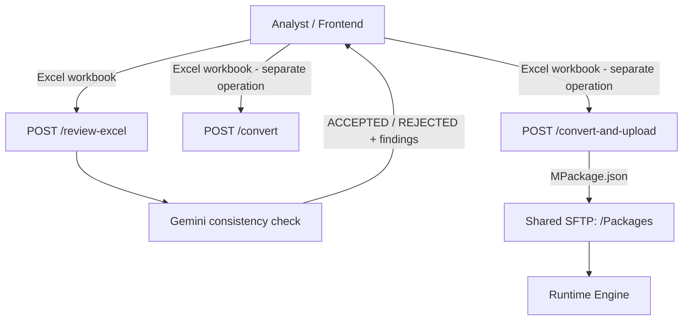
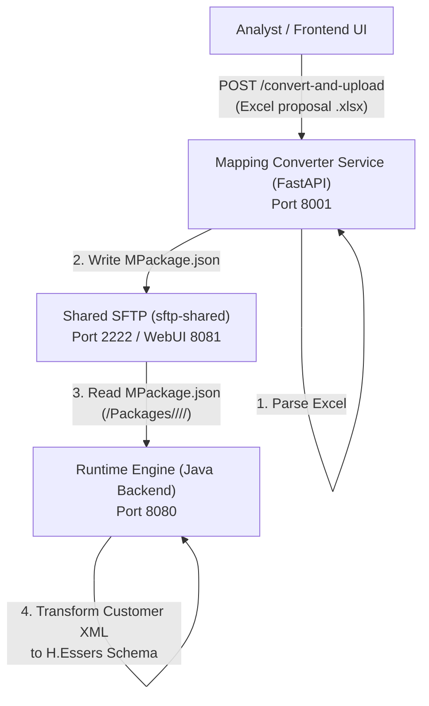

# Mapping Converter Service

The **Mapping Converter Service** is a FastAPI microservice in the H.Essers Mapping Platform. It is responsible for parsing approved customer Excel mapping proposals into standardized JSON mapping packages and uploading them directly to the shared SFTP storage (`sftp-shared`).

These JSON mapping packages contain the exact `source_path` and `target_path` pairs required by the Runtime Engine (Java backend) to automatically process and convert incoming customer XML documents into the standardized H.Essers logistics schemas.

---

# Mapping Converter Service

The **Mapping Converter Service** is a FastAPI microservice in the H. Essers Mapping Platform. It provides two currently independent capabilities:

1. **Gemini Excel consistency review** — examines a mapping proposal workbook for internal contradictions and returns an `ACCEPTED` or `REJECTED` decision with findings.
2. **Excel-to-JSON conversion** — converts an approved mapping proposal into a structured `MPackage.json`, optionally uploading it to shared SFTP storage for the Runtime Engine.

> **Important:** These are separate API operations. At present, `/convert` and `/convert-and-upload` **do not automatically invoke** `/review-excel` or verify a prior AI acceptance. The approval gate must be integrated into the full workflow before relying on it to prevent publication of rejected workbooks.

## Architecture



### Main files

| File | Responsibility |
| --- | --- |
| `api.py` | FastAPI endpoints, upload validation, and HTTP responses |
| `scripts/pipeline.py` | Coordinates Excel extraction and Gemini review |
| `scripts/excel_review.py` | Extracts mapping fields from uploaded `.xlsx` workbooks |
| `scripts/gemini_review.py` | Calls Gemini and interprets its structured response |
| `scripts/config.py` | Loads review settings from the repository-root `.env` or environment |
| `review_prompt.txt` | Gemini review instructions and decision guidance |
| `converter.py` | Parses mapping workbooks into JSON mapping packages |
| `models.py` | Mapping package and API response models |
| `sftp_service.py` | SFTP configuration, directory handling, and package upload |
| `tests/` | API, Excel review, converter, architecture, and SFTP-related tests |

## API endpoints

| Method | Endpoint | Purpose |
| --- | --- | --- |
| `GET` | `/health` | Service health check |
| `GET` | `/` | Service identifier |
| `POST` | `/review-excel` | Gemini consistency review; does not upload a package |
| `POST` | `/convert` | Convert an Excel mapping proposal to JSON without uploading |
| `POST` | `/convert-and-upload` | Convert Excel to JSON and upload `MPackage.json` to SFTP |
| `POST` | `/convert/save` | Alias for `/convert-and-upload`; hidden from Swagger |

Swagger documentation: <http://localhost:8001/docs>

### Gemini consistency review: `POST /review-excel`

Upload a `.xlsx` workbook as multipart form field `file`. The service extracts mapping details from the **Mapping Proposal** worksheet and asks Gemini to assess internal consistency, including suspicious duplicate target fields, conflicting source mappings, and obvious rule contradictions. Conditional or otherwise justified mappings need not be rejected.

A successful request returns HTTP `200` with a result such as:

```json
{
  "decision": "REJECTED",
  "summary": "Conflicting target mappings were detected.",
  "findings": [
    "Two unconditional mappings target the same CITY field with different source paths."
  ],
  "checked_mappings": 96
}
```

The example above is illustrative. `findings` are currently strings, not structured objects with separate mapping/problem/suggestion properties.

- `decision: "ACCEPTED"` means the workbook passed Gemini's consistency review, **not** that business mapping correctness was independently verified.
- `decision: "REJECTED"` indicates Gemini found actionable inconsistencies.
- HTTP `400` means an unsupported file extension; `422` means an invalid or unsupported workbook; `503` means the AI review is unavailable. **None of these error responses is an acceptance.**

The review uses **only fields extracted from the uploaded Excel**. It does not access historical XML data or write results to SFTP. Only upload files that your organization permits sending to the configured AI provider.

Example:

```bash
curl -F "file=@mapping_package.xlsx" http://localhost:8001/review-excel
```

### Excel-to-JSON preview: `POST /convert`

Accepts multipart form field `file` and returns a JSON mapping package without writing to SFTP. It reads source/target paths from the workbook according to the conversion implementation:

- Source path: `Source full path`, with supported fallbacks to source segment and field columns.
- Target path: the target segment path combined with the target field name.

```bash
curl -F "file=@mapping_package.xlsx" http://localhost:8001/convert
```

### Convert and upload: `POST /convert-and-upload`

Accepts a multipart upload and writes a JSON mapping package to the shared SFTP server.

| Form field | Required | Meaning |
| --- | --- | --- |
| `file` | Yes | Excel mapping workbook |
| `company` | Yes | Customer/company name, e.g. `nouryon` |
| `version` | Yes | Version identifier, e.g. `v4` |
| `message_type` | Yes | Mapping direction, e.g. `outbound` |
| `user_created` | No | Analyst identifier; defaults to `analist_a` |
| `package_version` | No | Optional package version override |

```bash
curl -X POST "http://localhost:8001/convert-and-upload" \
  -F "file=@mapping_package.xlsx" \
  -F "company=nouryon" \
  -F "version=v4" \
  -F "message_type=outbound" \
  -F "user_created=analist_a"
```

On success the endpoint returns HTTP `201` with upload details and the mapping package. Invalid inputs may return `400`; SFTP errors may return `502`; unexpected server errors may return `500`. This endpoint **does not currently enforce AI approval**.

### Mapping package structure

A converted package contains metadata and a list of source-to-target mappings:

```json
{
  "schema_version": "1.0",
  "meta": {
    "client_name": "nouryon",
    "package_version": "1.0.0",
    "package_type": "inbound",
    "date_created": "2026-11-20T12:00:00Z",
    "user_created": "analist_a"
  },
  "mappings": [
    {
      "source_path": "/DELVRY03/IDOC/E1EDL20/VBELN",
      "target_path": "/SHP_OBDLV_SAVE_REPLICA05/IDOC/E1BPOBDLVHDR/DELIV_NUMB"
    }
  ]
}
```

This example shows the general shape, not a promise of exact metadata values.

### SFTP storage

Uploaded packages are stored under:

```text
/Packages/<company>/<version>/<message_type>/MPackage.json
```

For example:

```text
/Packages/nouryon/v4/outbound/MPackage.json
```

Company names, message types, and version folder names are normalized by the SFTP service.

## Local development

From `Mapping_Converter/`:

```powershell
python -m pip install -r requirements.txt
```

Set `GEMINI_API_KEY` and optionally `GEMINI_REVIEW_MODEL` (falling back to `GEMINI_MODEL`) in the **repository-root `.env`** or the process environment. The review service uses the shared root configuration for local development. Never commit API keys or real passwords.

If testing SFTP uploads locally, configure `SFTP_SHARED_HOST`, `SFTP_SHARED_PORT`, `SFTP_SHARED_USER`, `SFTP_SHARED_PASSWORD`, and `SFTP_SHARED_PACKAGES_DIR` as appropriate for your environment. The Docker SFTP containers can be started from `Mapping_Converter/`:

```powershell
docker compose -f ../Scripts/docker-compose.sftp.yml up -d
```

Run the service:

```powershell
python -m uvicorn api:app --reload --port 8001
```

Open <http://localhost:8001/docs> to upload a workbook using Swagger. The shared SFTPGo web interface is typically accessible locally at <http://localhost:8081> when the corresponding Docker service is running.

If using a virtual environment on Windows PowerShell:

```powershell
python -m venv .venv
.\.venv\Scripts\Activate.ps1
python -m pip install -r requirements.txt
```

On Linux/macOS, activation is `source .venv/bin/activate` instead.

## Tests

From `Mapping_Converter/`:

```powershell
python -m pytest -q
python -m ruff check .
```

The tests cover relevant review and conversion behavior without requiring a live Gemini API call for ordinary unit tests. Check the test modules for any environment-dependent SFTP integration setup.

## Known integration work

- Connect the frontend/Version Control approval flow to `/review-excel`.
- Allow conversion and package publication **only after** a successful acceptance for the submitted workbook.
- Persist the latest AI review result in the existing proposal metadata (`proposal.json`) through the designated storage-owning service, without creating a new version for rejected workbooks.
- Return actionable review findings to the frontend. Today, `findings` are plain strings; structured mapping/problem/suggestion objects would require extending the response contract.



### Responsibilities:
- **Input**: Approved customer mapping proposal spreadsheet (`.xlsx` formatted according to the standard Nouryon layout).
- **Extraction**: Reads the `'Mapping Proposal'` sheet, extracting:
  - **Source Path**: `Source full path` (with fallback to `Source segment path` / `Source field name`).
  - **Target Path**: Combined `Target segment path` and `Target field name` (e.g. `/SHP_OBDLV_SAVE_REPLICA05/IDOC/E1BPOBDLVHDR/DELIV_NUMB`).
- **Metadata Generation**: Adds a header containing `schema_version` and `meta` (client name, package version, message type, UTC creation date, author).
- **Output**: Standardized JSON mapping package adhering to the schema expected by the Runtime Engine.
- **SFTP Storage**: Writes the resulting JSON directly to the shared SFTP server under the standardized directory structure:
  ```
  /Packages/<companyName>/<version>/<type>/MPackage.json
  ```

---

## Output JSON Schema & Example

The output JSON mapping package places metadata and version information at the top of the file:

```json
{
  "schema_version": "1.0",
  "meta": {
    "client_name": "nouryon",
    "package_version": "1.0.0",
    "package_type": "inbound",
    "date_created": "2024-06-19T12:00:00Z",
    "user_created": "analist_a"
  },
  "mappings": [
    {
      "source_path": "/DELVRY03/IDOC/E1EDL20/VBELN",
      "target_path": "/SHP_OBDLV_SAVE_REPLICA05/IDOC/E1BPOBDLVHDR/DELIV_NUMB"
    },
    {
      "source_path": "/DELVRY03/IDOC/E1EDL20/E1EDT13/NTANF",
      "target_path": "/SHP_OBDLV_SAVE_REPLICA05/IDOC/E1SHP_OBDLV_SAVE_REPLICA/E1BPDLVDEADLN/TIMESTAMP_UTC"
    }
  ]
}
```

---

## SFTP Directory Structure & Naming Conventions

Remote directory layout on the shared SFTP server (`sftp-shared`):

```
/Packages
└── <companyName>
    └── <version>
        └── <message_type>
            └── MPackage.json
```

### Examples:
| Type | Full SFTP Path |
| :--- | :--- |
| **Inbound** | `/Packages/nouryon/v3/inbound/MPackage.json` |
| **Outbound** | `/Packages/nouryon/v4/outbound/MPackage.json` |

- **Folder version normalization**: Versions are automatically normalized to `v<N>` (e.g., `"4"`, `"V4"`, or `"v4"` become `"v4"`).
- **Company & Type normalization**: Slugs are lowercase and trimmed (e.g., `"Nouryon "` becomes `"nouryon"`).

---

## API Endpoints

| Method | Endpoint | Description |
| :--- | :--- | :--- |
| `GET` | `/health` | Health check endpoint returning `{"status": "ok", "service": "mapping-converter"}` |
| `GET` | `/` | Service root identifier message |
| `POST` | `/convert-and-upload` | **(Main)** Converts Excel proposal, attaches metadata header, and uploads `MPackage.json` to SFTP |
| `POST` | `/convert/save` | Alias for `/convert-and-upload` |
| `POST` | `/convert` | **(Dry-run / Preview)** Converts Excel proposal to JSON without uploading to SFTP |

### Detailed Specification for `POST /convert-and-upload`:

- **Content-Type**: `multipart/form-data`
- **Request Parameters**:
  - `file` *(UploadFile, required)*: The Excel proposal workbook (`.xlsx` or `.xls`).
  - `company` *(string, required)*: Customer / client name (e.g. `nouryon`).
  - `version` *(string, required)*: Version identifier (e.g. `v4`, `4`, or `1.0.0`).
  - `message_type` *(string, required)*: Message flow type (e.g. `inbound` or `outbound`).
  - `user_created` *(string, optional, default: `"analist_a"`)*: Analyst or author username.
  - `package_version` *(string, optional)*: Explicit semantic version override (defaults to e.g. `1.0.0` or `<version>.0.0`).

- **Responses**:
  - `201 Created`: Mapping package converted and successfully stored on SFTP.
  - `400 Bad Request`: Invalid file format (non-Excel), empty file, or missing parameters.
  - `502 Bad Gateway`: Unable to connect or authenticate to the SFTP server.

---

## Environment Variables & Configuration

The service uses environment variables from `../.env` or system environment. Sensible defaults are included for local Docker development:

| Variable | Local Default | Production (K8s) | Description |
| :--- | :--- | :--- | :--- |
| `SFTP_SHARED_HOST` | `localhost` | `sftp-shared` | Hostname of the SFTP server (`"none"` for local file fallback) |
| `SFTP_SHARED_PORT` | `2222` | `22` | SSH/SFTP port |
| `SFTP_SHARED_USER` | `shareduser` | `shareduser` | SFTP username |
| `SFTP_SHARED_PASSWORD` | `devpassword` | *(from Secret)* | SFTP password |
| `SFTP_SHARED_PACKAGES_DIR` | `/Packages` | `/Packages` | Base remote directory for mapping packages |
| `SFTP_ALLOW_UNKNOWN_KEYS` | `true` | `true` | Accept SFTP host keys automatically |

---

## Local Development Guide

### 1. Install Dependencies
Make sure you are using Python 3.12+ (or 3.14):

```bash
cd Mapping_Converter
python3 -m venv .venv
source .venv/bin/activate
pip install -r requirements.txt
```

### 2. Start the Local SFTP Storage (Docker)
The service expects the shared SFTP server to be running:

```bash
docker compose -f ../Scripts/docker-compose.sftp.yml up -d
```
*(If your user is not yet in the docker group, run with `sudo`)*.

- **SFTP Endpoint**: `localhost:2222` (`shareduser` / `devpassword`)
- **Web File Manager**: [http://localhost:8081](http://localhost:8081)

### 3. Start the Converter Service
Run Uvicorn with auto-reload on port **8001**:

```bash
uvicorn api:app --reload --port 8001
```

The service will be available at:
- **API Base**: `http://localhost:8001`
- **Swagger Documentation**: [http://localhost:8001/docs](http://localhost:8001/docs)

### 4. Stop the SFTP Storage
When finished:

```bash
docker compose -f ../Scripts/docker-compose.sftp.yml down
```
*(Add `-v` to wipe test volumes and uploaded packages: `docker compose -f ../Scripts/docker-compose.sftp.yml down -v`)*.

---

## Usage Examples

### A. Via cURL (Upload to SFTP)
```bash
curl -X POST "http://localhost:8001/convert-and-upload" \
  -F "file=@../Mapping_Proposal/templates/mapping_template.xlsx" \
  -F "company=nouryon" \
  -F "version=v4" \
  -F "message_type=outbound" \
  -F "user_created=analist_a"
```

### B. Via cURL (Dry-Run / Preview JSON Only)
```bash
curl -X POST "http://localhost:8001/convert" \
  -F "file=@../Mapping_Proposal/templates/mapping_template.xlsx"
```

### C. Programmatic Python Call
```python
from converter import convert_excel_to_sftp

package, sftp_path = convert_excel_to_sftp(
    excel_source="proposal.xlsx",
    company="nouryon",
    version="v4",
    message_type="outbound",
    user_created="analist_a",
)

print(f"Uploaded mapping package to: {sftp_path}")
print(f"Total mappings: {len(package.mappings)}")
```

---

## Running Automated Tests

Run the full pytest suite with branch coverage:

```bash
cd Mapping_Converter
pytest -v --cov=. --cov-branch --cov-report=term-missing
```

### Test Structure:
- `tests/test_api.py`: Tests FastAPI endpoints (`/health`, `/`, `/convert`, `/convert-and-upload`, input validation, error handling).
- `tests/test_converter.py`: Tests Excel parsing, sheet detection, path extraction, and fallbacks.
- `tests/test_sftp_service.py`: Tests slug normalization, semantic versioning, path building, SFTP folder creation, and Paramiko uploads.
