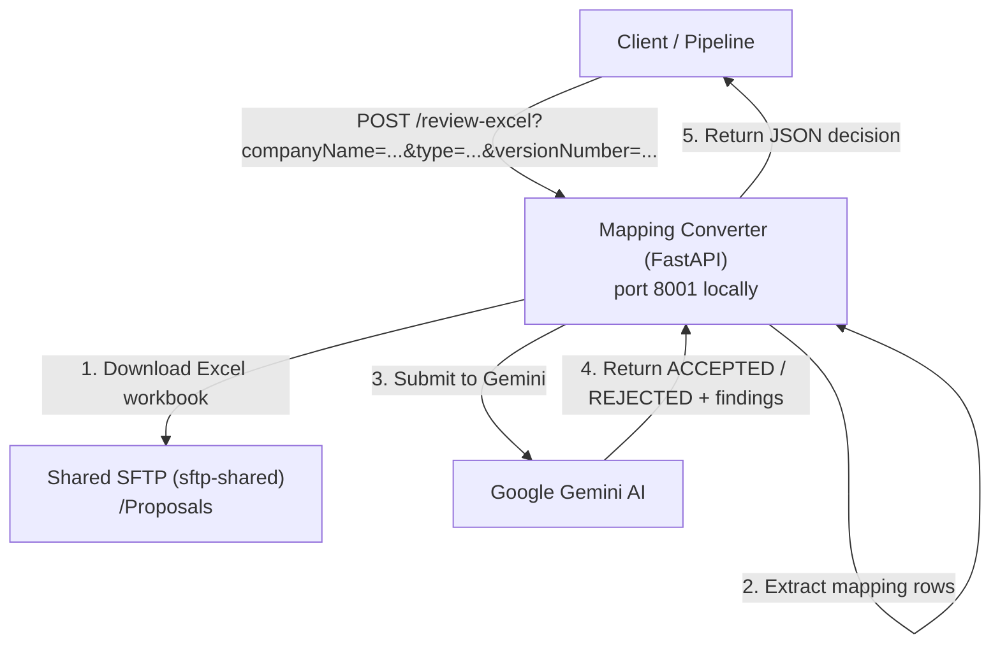
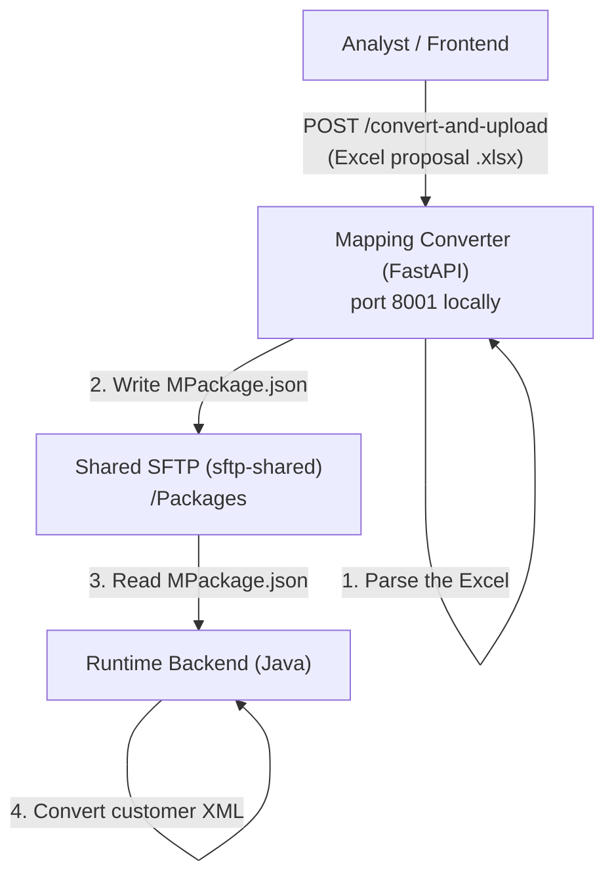

# H.Essers — Mapping Converter

**Goal:** Take a mapping proposal that an analyst has reviewed and carry it through the rest of the design-time flow: from **approving** the proposal up to storing the **JSON mapping package** on the SFTP server. The package contains the exact `source_path` / `target_path` pairs the Runtime Backend (Java) uses to convert incoming customer XML into the standardized H.Essers schemas. It also includes an automated **AI Review** gate using Gemini to verify mapping consistency before deployment.

This service does **not** generate proposals (that is `Mapping_Proposal`) and does **not** convert customer messages at runtime (that is `Runtime`).

## What happens when you approve a proposal?

1. **The analyst clicks "Goedkeuren"** in the frontend and fills in a short description of the change ("Eerste versie voor <klant>" is suggested for v1).
2. **The frontend calls `POST /approve`** on this service (through `/api/converter/*`).
3. **The converter checks the proposal** on the shared SFTP server (`sftp-shared`): it must exist and be in review (`READY_FOR_REVIEW`, `IN_REVIEW` or `In review`).
4. **The converter updates the metadata** of that version: status `AI_CHECKING_REVIEW` ("AI-controle bezig"), `ai_status: RUNNING`, the description and the approval time. The analyst gets an answer straight away.
5. **The AI review runs in the background** and the result becomes a mapping package or goes back to the analyst, see [After the AI review](#after-the-ai-review-story-187). While it runs, the proposal cannot be approved again, and Home refreshes by itself.

## What happens during the AI review?



1. **Workbook Retrieval**: Retrieves the proposal workbook directly from SFTP (`/Proposals/<company>/<version>/<type>/`).
2. **Parsing** (`scripts/excel_review.py`): Safely parses mapping rows (`Mapping ID`, `Source full path`, `Target field name`, `Proposed rule type`) without formula execution.
3. **AI Consistency Gate** (`scripts/gemini_review.py`): Prompts Gemini to evaluate mappings against domain constraints and returns `ACCEPTED` or `REJECTED` with findings.

## After the AI review (story 187)

`trigger_ai_review` in `routers/approve.py` hands the approved proposal to `services/finalization.py`:

| AI decision | What is stored | Proposal status |
|---|---|---|
| `ACCEPTED` | `MPackage.json` as a new version in `/Packages/<company>/v<N>/<proposal_type>/`, with the approval description and time in `meta` (`description`, `approved_at`). That version becomes the active one in `/Packages/<company>/active.json`. | `APPROVED` ("Goedgekeurd") |
| `REJECTED` or an invalid workbook | nothing; the findings are kept in `ai_review` of the metadata | `RETURNED` ("Teruggestuurd"), `ai_status: FAILED` |
| review unavailable (Gemini, storage, ...) | nothing; the error is kept in `ai_review_error` | stays `AI_CHECKING_REVIEW`, `ai_status: FAILED`, so `POST /ai-retry` can start it again |

- **Version number:** the package gets the version of the proposal. Mapping_Proposal already numbers a new proposal as "latest package + 1" (v1 for a new customer).
- **Never overwritten:** if the package of that version already exists, nothing is stored and the review counts as failed.
- **`active.json`** has the same format as Version_Control writes, one entry per package type; the other types keep their active version:

```json
{
  "outbound": { "version": "v2", "updated_at": "2026-11-27T09:20:39+00:00", "updated_by": "analist_a" }
}
```

## What happens when you convert a proposal?



1. **Input:** an approved mapping proposal workbook (`.xlsx`, the standard template that Mapping_Proposal writes).
2. **Extraction** (`services/excel_converter.py`): reads the `Mapping Proposal` sheet (or the first sheet named like it) and takes per row:
   - **Source path:** `Source full path`, or `Source segment path` + `Source field name`.
   - **Target path:** `Target full path`, or `Target segment path` + `Target field name`.
   Rows without a target path are skipped.
3. **Metadata** (`services/packages.py`): adds `schema_version` and a `meta` header (client name, package version, proposal type, UTC creation date, author).
4. **Storage:** writes `MPackage.json` atomically to `/Packages/<company>/<version>/<proposal_type>/`.

## Project folders

```text
Mapping_Converter/
├── api.py                  HTTP API (FastAPI): creates the app and registers routers/
├── requirements.txt        Python packages to install
├── pyproject.toml          pytest and ruff settings
├── Dockerfile              Container image (python:3.12-slim, port 8000)
├── review_prompt.txt       System prompt for Gemini mapping review
├── routers/                HTTP endpoints, one file per resource (thin: they call services/)
│   ├── approve.py          POST /approve – approve a reviewed proposal
│   ├── convert.py          POST /convert and /convert-and-upload – Excel proposal -> JSON package
│   └── review.py           POST /review-excel – AI review of Excel proposal from SFTP
├── services/               Business logic
│   ├── approval.py         Validation and status update when a proposal is approved
│   ├── excel_converter.py  Parse an Excel mapping proposal into a MappingPackage
│   ├── finalization.py     After the AI review: mapping package + active version, or back to the analyst
│   ├── packages.py         Name, add metadata to and store MPackage.json
│   ├── proposal_files.py   Find a proposal version and read/write its metadata
│   ├── statuses.py         ProposalStatus enum and the statuses that may be approved
│   └── storage.py          Connection to the shared SFTP server (or a local stand-in folder)
├── scripts/                Shared basics and AI review pipeline
│   ├── config.py           Settings from the shared .env in the repo root (read in one place)
│   ├── errors.py           Clear error types (StorageError, ProposalNotFoundError, ...)
│   ├── excel_review.py     Safe Excel parser for Gemini review
│   ├── gemini_review.py    Gemini SDK integration and schema validation
│   ├── models.py           Pydantic models: MappingEntry, PackageMeta, MappingPackage, responses
│   ├── pipeline.py         Orchestrator for Excel-to-Gemini review
│   └── safe_files.py       Safe paths and atomic file writes
├── sftp_service.py         SFTP client operations for proposal retrieval and package storage
└── tests/
    ├── conftest.py         Shared fixtures (temporary proposals/packages folders, a mapping workbook)
    ├── api/                Endpoint tests with FastAPI's TestClient
    ├── unit/               Tests for services/ and scripts/
    ├── test_architecture.py AI review configuration tests
    ├── test_review.py      AI review endpoint and pipeline tests
    └── test_sftp_service.py Tests for SFTP operations
```

## First-time setup (Windows / VS Code)

1. Open the **`Mapping_Converter` folder** in a PowerShell terminal.
2. Make sure Python 3.12 or later is installed.
3. Create a virtual environment and install the dependencies:

   ```powershell
   python -m venv .venv
   .\.venv\Scripts\Activate.ps1
   python -m pip install -r requirements.txt
   ```

4. Install the shared CI tools (pytest, pytest-cov, ruff) used by the pipeline:

   ```powershell
   python -m pip install -r ..\.github\requirements\python-ci.txt
   ```

## Configuration

This service reads **one shared `.env` in the repository root** (`Essers_Mapping/.env`), created from `.env.example`:

```powershell
Copy-Item ..\.env.example ..\.env
```

Variables that are already set in the terminal or in Kubernetes always win over the `.env` file.

| Variable | Meaning | Local value |
|---|---|---|
| `GEMINI_API_KEY` | API key for Google Gemini AI review | `<your-api-key>` |
| `GEMINI_REVIEW_MODEL` | Gemini model for mapping reviews (fallback: `GEMINI_MODEL`) | `gemini-2.5-flash` |
| `SFTP_SHARED_HOST` | Shared SFTP server; empty = use the local folder `data/sftp-shared/` | `localhost` |
| `SFTP_SHARED_PORT` | SFTP port | `2222` |
| `SFTP_SHARED_USER` | SFTP user | `sftpuser` |
| `SFTP_SHARED_PASSWORD` | SFTP password | `sftppass` |
| `SFTP_SHARED_PROPOSALS_DIR` | Folder with the proposals | `/Proposals` |
| `SFTP_SHARED_PACKAGES_DIR` | Folder for the mapping packages | `/Packages` |
| `CORS_ORIGINS` | Only when a browser calls this API directly | `http://localhost:5173` |

**Never commit `.env`.** It is ignored by Git.

## API

| Endpoint | Returns |
|---|---|
| `GET /health` | `{"status": "ok", "service": "mapping-converter"}` |
| `POST /approve` | approves a reviewed proposal, sets status to `AI_CHECKING_REVIEW` and starts the AI review in the background; when it passes, the proposal becomes a mapping package |
| `POST /ai-retry` | restarts the AI review of proposals that are stuck in `AI_CHECKING_REVIEW` (optional filters `company`, `version`, `proposalType`) |
| `POST /convert` | converts an Excel proposal and stores `MPackage.json` on SFTP (`/convert-and-upload` and `/convert/save` are hidden aliases) |

### POST /approve

```http
POST /approve?company=voorbeeldbedrijf-b&version=v2&proposalType=outbound
Content-Type: application/json

{"description": "Leverdatum mapt nu op DeliveryDate in plaats van OrderDate"}
```

| Parameter | Rules |
|---|---|
| `company` (query) | Required, max. 20 characters, case-insensitive |
| `version` (query) | Required, format `v<number>` (e.g. `v1`) |
| `proposalType` (query) | Required, max. 20 characters, case-insensitive (e.g. `inbound`) |
| `description` (body) | Optional, max. 200 characters (trimmed) |

Response `200 OK`:

```json
{
  "company": "voorbeeldbedrijf-b",
  "version": "v2",
  "proposal_type": "outbound",
  "status": "AI_CHECKING_REVIEW",
  "approval_description": "Leverdatum mapt nu op DeliveryDate in plaats van OrderDate",
  "approved_at": "2026-11-20T10:00:00+00:00"
}
```

### POST /convert

Takes `multipart/form-data` with the workbook in `file` (`.xlsx` or `.xls`) and stores `MPackage.json` on SFTP:

| Form field | Rules |
|---|---|
| `file` | Required, Excel mapping proposal workbook |
| `company` | Required, e.g. `nouryon` (normalized to a lowercase slug) |
| `version` | Required, e.g. `v4`, `4` or `1.0.0` (folder normalized to `v<N>`) |
| `proposal_type` | Required, e.g. `inbound` or `outbound` (lowercase slug) |
| `user_created` | Optional, default `analist_a` |
| `package_version` | Optional semantic version; default `<N>.0.0` from `version` |

## Tests

From `Mapping_Converter/`:

```powershell
python -m pytest --cov=services --cov=scripts --cov=routers
python -m ruff check .
```

The tests never use the real SFTP server: they use a temporary folder or a fake SFTP client.

## Kubernetes

The service runs as the `mapping-converter` deployment (`Kubernetes/base/preparation/mapping-converter.yaml`), listens on port 8000 and is only reachable through the frontend, which proxies `/api/converter/*`.
