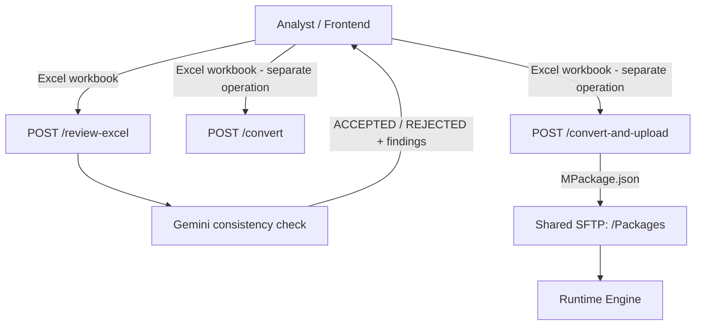
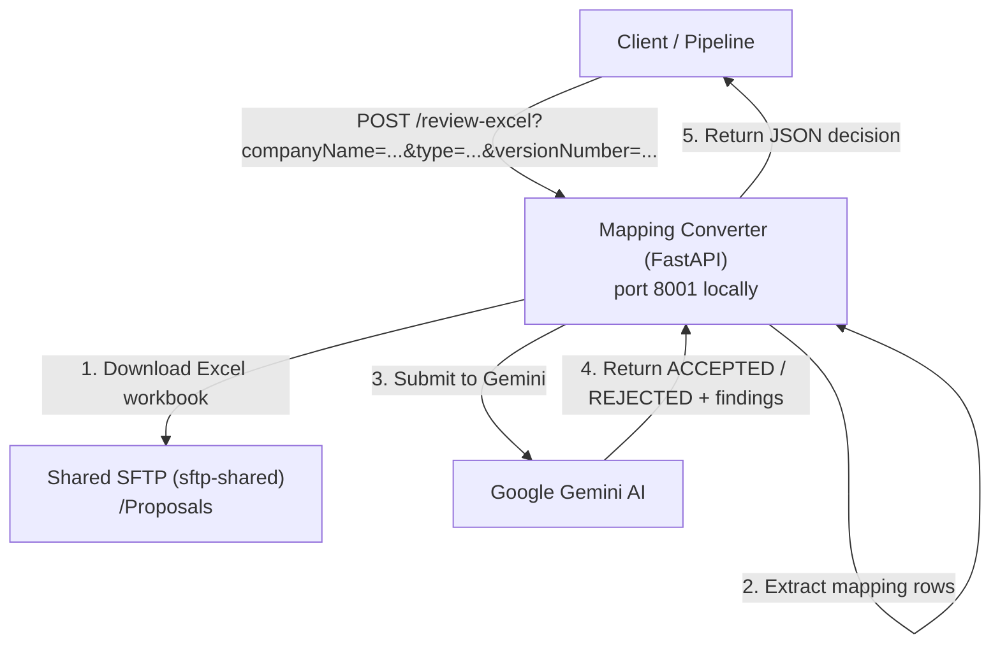
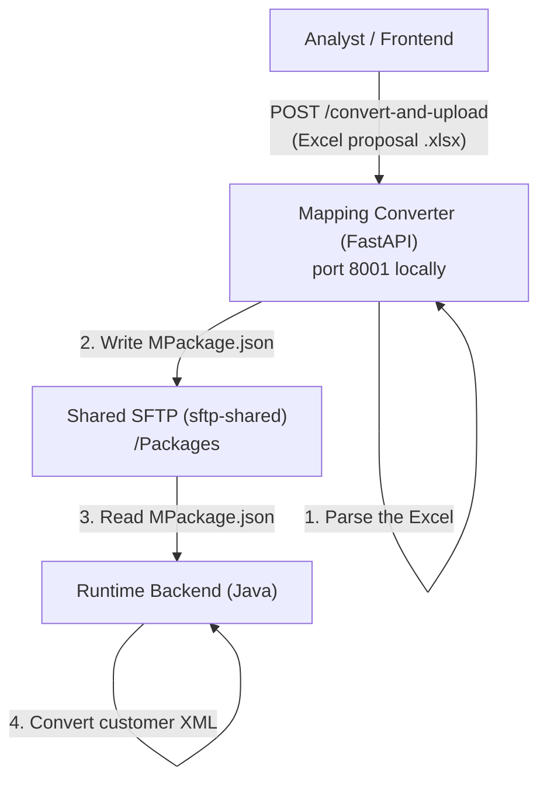

# H.Essers — Mapping Converter

**Goal:** Take a mapping proposal that an analyst has reviewed and carry it through the rest of the design-time flow: from **approving** the proposal up to storing the **JSON mapping package** on the SFTP server. The package contains the exact `source_path` / `target_path` pairs the Runtime Backend (Java) uses to convert incoming customer XML into the standardized H.Essers schemas. It also includes an automated **AI Review** gate using Gemini to verify mapping consistency before deployment.

This service does **not** generate proposals (that is `Mapping_Proposal`) and does **not** convert customer messages at runtime (that is `Runtime`).

## What happens when you approve a proposal?

# Mapping Converter Service

The **Mapping Converter Service** is a FastAPI microservice in the H. Essers Mapping Platform. It provides two currently independent capabilities:

1. **Gemini Excel consistency review** — examines a mapping proposal workbook for internal contradictions and returns an `ACCEPTED` or `REJECTED` decision with findings.
2. **Excel-to-JSON conversion** — converts an approved mapping proposal into a structured `MPackage.json`, optionally uploading it to shared SFTP storage for the Runtime Engine.

> **Important:** These are separate API operations. At present, `/convert` and `/convert-and-upload` **do not automatically invoke** `/review-excel` or verify a prior AI acceptance. The approval gate must be integrated into the full workflow before relying on it to prevent publication of rejected workbooks.

## Architecture



### Main files

| File | Responsibility |
| --- | --- |
| `api.py` | FastAPI endpoints, upload validation, and HTTP responses |
| `scripts/pipeline.py` | Coordinates Excel extraction and Gemini review |
| `scripts/excel_review.py` | Extracts mapping fields from uploaded `.xlsx` workbooks |
| `scripts/gemini_review.py` | Calls Gemini and interprets its structured response |
| `scripts/config.py` | Loads review settings from the repository-root `.env` or environment |
| `review_prompt.txt` | Gemini review instructions and decision guidance |
| `converter.py` | Parses mapping workbooks into JSON mapping packages |
| `models.py` | Mapping package and API response models |
| `sftp_service.py` | SFTP configuration, directory handling, and package upload |
| `tests/` | API, Excel review, converter, architecture, and SFTP-related tests |

## API endpoints

| Method | Endpoint | Purpose |
| --- | --- | --- |
| `GET` | `/health` | Service health check |
| `GET` | `/` | Service identifier |
| `POST` | `/review-excel` | Gemini consistency review; does not upload a package |
| `POST` | `/convert` | Convert an Excel mapping proposal to JSON without uploading |
| `POST` | `/convert-and-upload` | Convert Excel to JSON and upload `MPackage.json` to SFTP |
| `POST` | `/convert/save` | Alias for `/convert-and-upload`; hidden from Swagger |

Swagger documentation: <http://localhost:8001/docs>

### Gemini consistency review: `POST /review-excel`

Upload a `.xlsx` workbook as multipart form field `file`. The service extracts mapping details from the **Mapping Proposal** worksheet and asks Gemini to assess internal consistency, including suspicious duplicate target fields, conflicting source mappings, and obvious rule contradictions. Conditional or otherwise justified mappings need not be rejected.

A successful request returns HTTP `200` with a result such as:

```json
{
  "decision": "REJECTED",
  "summary": "Conflicting target mappings were detected.",
  "findings": [
    "Two unconditional mappings target the same CITY field with different source paths."
  ],
  "checked_mappings": 96
}
```

The example above is illustrative. `findings` are currently strings, not structured objects with separate mapping/problem/suggestion properties.

- `decision: "ACCEPTED"` means the workbook passed Gemini's consistency review, **not** that business mapping correctness was independently verified.
- `decision: "REJECTED"` indicates Gemini found actionable inconsistencies.
- HTTP `400` means an unsupported file extension; `422` means an invalid or unsupported workbook; `503` means the AI review is unavailable. **None of these error responses is an acceptance.**

The review uses **only fields extracted from the uploaded Excel**. It does not access historical XML data or write results to SFTP. Only upload files that your organization permits sending to the configured AI provider.

Example:

```bash
curl -F "file=@mapping_package.xlsx" http://localhost:8001/review-excel
```

### Excel-to-JSON preview: `POST /convert`

Accepts multipart form field `file` and returns a JSON mapping package without writing to SFTP. It reads source/target paths from the workbook according to the conversion implementation:

- Source path: `Source full path`, with supported fallbacks to source segment and field columns.
- Target path: the target segment path combined with the target field name.

```bash
curl -F "file=@mapping_package.xlsx" http://localhost:8001/convert
```

### Convert and upload: `POST /convert-and-upload`

Accepts a multipart upload and writes a JSON mapping package to the shared SFTP server.

| Form field | Required | Meaning |
| --- | --- | --- |
| `file` | Yes | Excel mapping workbook |
| `company` | Yes | Customer/company name, e.g. `nouryon` |
| `version` | Yes | Version identifier, e.g. `v4` |
| `message_type` | Yes | Mapping direction, e.g. `outbound` |
| `user_created` | No | Analyst identifier; defaults to `analist_a` |
| `package_version` | No | Optional package version override |

```bash
curl -X POST "http://localhost:8001/convert-and-upload" \
  -F "file=@mapping_package.xlsx" \
  -F "company=nouryon" \
  -F "version=v4" \
  -F "message_type=outbound" \
  -F "user_created=analist_a"
```

On success the endpoint returns HTTP `201` with upload details and the mapping package. Invalid inputs may return `400`; SFTP errors may return `502`; unexpected server errors may return `500`. This endpoint **does not currently enforce AI approval**.

### Mapping package structure

A converted package contains metadata and a list of source-to-target mappings:

```json
{
  "schema_version": "1.0",
  "meta": {
    "client_name": "nouryon",
    "package_version": "1.0.0",
    "package_type": "inbound",
    "date_created": "2026-11-20T12:00:00Z",
    "user_created": "analist_a"
  },
  "mappings": [
    {
      "source_path": "/DELVRY03/IDOC/E1EDL20/VBELN",
      "target_path": "/SHP_OBDLV_SAVE_REPLICA05/IDOC/E1BPOBDLVHDR/DELIV_NUMB"
    }
  ]
}
```

This example shows the general shape, not a promise of exact metadata values.

### SFTP storage

Uploaded packages are stored under:

```text
/Packages/<company>/<version>/<message_type>/MPackage.json
```

For example:

```text
/Packages/nouryon/v4/outbound/MPackage.json
```

Company names, message types, and version folder names are normalized by the SFTP service.

## Local development

From `Mapping_Converter/`:

```powershell
python -m pip install -r requirements.txt
```

Set `GEMINI_API_KEY` and optionally `GEMINI_REVIEW_MODEL` (falling back to `GEMINI_MODEL`) in the **repository-root `.env`** or the process environment. The review service uses the shared root configuration for local development. Never commit API keys or real passwords.

If testing SFTP uploads locally, configure `SFTP_SHARED_HOST`, `SFTP_SHARED_PORT`, `SFTP_SHARED_USER`, `SFTP_SHARED_PASSWORD`, and `SFTP_SHARED_PACKAGES_DIR` as appropriate for your environment. The Docker SFTP containers can be started from `Mapping_Converter/`:

```powershell
docker compose -f ../Scripts/docker-compose.sftp.yml up -d
```

Run the service:

```powershell
python -m uvicorn api:app --reload --port 8001
```

Open <http://localhost:8001/docs> to upload a workbook using Swagger. The shared SFTPGo web interface is typically accessible locally at <http://localhost:8081> when the corresponding Docker service is running.

If using a virtual environment on Windows PowerShell:

```powershell
python -m venv .venv
.\.venv\Scripts\Activate.ps1
python -m pip install -r requirements.txt
```

On Linux/macOS, activation is `source .venv/bin/activate` instead.

## Tests

From `Mapping_Converter/`:

```powershell
python -m pytest -q
python -m ruff check .
```

The tests cover relevant review and conversion behavior without requiring a live Gemini API call for ordinary unit tests. Check the test modules for any environment-dependent SFTP integration setup.

## Known integration work

- Connect the frontend/Version Control approval flow to `/review-excel`.
- Allow conversion and package publication **only after** a successful acceptance for the submitted workbook.
- Persist the latest AI review result in the existing proposal metadata (`proposal.json`) through the designated storage-owning service, without creating a new version for rejected workbooks.
- Return actionable review findings to the frontend. Today, `findings` are plain strings; structured mapping/problem/suggestion objects would require extending the response contract.



1. **Workbook Retrieval**: Retrieves the proposal workbook directly from SFTP (`/Proposals/<company>/<version>/<type>/`).
2. **Parsing** (`scripts/excel_review.py`): Safely parses mapping rows (`Mapping ID`, `Source full path`, `Target field name`, `Proposed rule type`) without formula execution.
3. **AI Consistency Gate** (`scripts/gemini_review.py`): Prompts Gemini to evaluate mappings against domain constraints and returns `ACCEPTED` or `REJECTED` with findings.

## What happens when you convert a proposal?



1. **Input:** an approved mapping proposal workbook (`.xlsx`, the standard template that Mapping_Proposal writes).
2. **Extraction** (`services/excel_converter.py`): reads the `Mapping Proposal` sheet (or the first sheet named like it) and takes per row:
   - **Source path:** `Source full path`, or `Source segment path` + `Source field name`.
   - **Target path:** `Target full path`, or `Target segment path` + `Target field name`.
   Rows without a target path are skipped.
3. **Metadata** (`services/packages.py`): adds `schema_version` and a `meta` header (client name, package version, proposal type, UTC creation date, author).
4. **Storage:** writes `MPackage.json` atomically to `/Packages/<company>/<version>/<proposal_type>/`.

## Project folders

```text
Mapping_Converter/
├── api.py                  HTTP API (FastAPI): creates the app and registers routers/
├── requirements.txt        Python packages to install
├── pyproject.toml          pytest and ruff settings
├── Dockerfile              Container image (python:3.12-slim, port 8000)
├── review_prompt.txt       System prompt for Gemini mapping review
├── routers/                HTTP endpoints, one file per resource (thin: they call services/)
│   ├── approve.py          POST /approve – approve a reviewed proposal
│   ├── convert.py          POST /convert and /convert-and-upload – Excel proposal -> JSON package
│   └── review.py           POST /review-excel – AI review of Excel proposal from SFTP
├── services/               Business logic
│   ├── approval.py         Validation and status update when a proposal is approved
│   ├── excel_converter.py  Parse an Excel mapping proposal into a MappingPackage
│   ├── packages.py         Name, add metadata to and store MPackage.json
│   ├── proposal_files.py   Find a proposal version and read/write its metadata
│   ├── statuses.py         ProposalStatus enum and the statuses that may be approved
│   └── storage.py          Connection to the shared SFTP server (or a local stand-in folder)
├── scripts/                Shared basics and AI review pipeline
│   ├── config.py           Settings from the shared .env in the repo root (read in one place)
│   ├── errors.py           Clear error types (StorageError, ProposalNotFoundError, ...)
│   ├── excel_review.py     Safe Excel parser for Gemini review
│   ├── gemini_review.py    Gemini SDK integration and schema validation
│   ├── models.py           Pydantic models: MappingEntry, PackageMeta, MappingPackage, responses
│   ├── pipeline.py         Orchestrator for Excel-to-Gemini review
│   └── safe_files.py       Safe paths and atomic file writes
├── sftp_service.py         SFTP client operations for proposal retrieval and package storage
└── tests/
    ├── conftest.py         Shared fixtures (a temporary proposals folder)
    ├── api/                Endpoint tests with FastAPI's TestClient
    ├── unit/               Tests for services/ and scripts/
    ├── test_architecture.py AI review configuration tests
    ├── test_review.py      AI review endpoint and pipeline tests
    └── test_sftp_service.py Tests for SFTP operations
```

## First-time setup (Windows / VS Code)

1. Open the **`Mapping_Converter` folder** in a PowerShell terminal.
2. Make sure Python 3.12 or later is installed.
3. Create a virtual environment and install the dependencies:

   ```powershell
   python -m venv .venv
   .\.venv\Scripts\Activate.ps1
   python -m pip install -r requirements.txt
   ```

4. Install the shared CI tools (pytest, pytest-cov, ruff) used by the pipeline:

   ```powershell
   python -m pip install -r ..\.github\requirements\python-ci.txt
   ```

## Configuration

This service reads **one shared `.env` in the repository root** (`Essers_Mapping/.env`), created from `.env.example`:

```powershell
Copy-Item ..\.env.example ..\.env
```

Variables that are already set in the terminal or in Kubernetes always win over the `.env` file.

| Variable | Meaning | Local value |
|---|---|---|
| `GEMINI_API_KEY` | API key for Google Gemini AI review | `<your-api-key>` |
| `GEMINI_REVIEW_MODEL` | Gemini model for mapping reviews (fallback: `GEMINI_MODEL`) | `gemini-2.5-flash` |
| `SFTP_SHARED_HOST` | Shared SFTP server; empty = use the local folder `data/sftp-shared/` | `localhost` |
| `SFTP_SHARED_PORT` | SFTP port | `2222` |
| `SFTP_SHARED_USER` | SFTP user | `sftpuser` |
| `SFTP_SHARED_PASSWORD` | SFTP password | `sftppass` |
| `SFTP_SHARED_PROPOSALS_DIR` | Folder with the proposals | `/Proposals` |
| `SFTP_SHARED_PACKAGES_DIR` | Folder for the mapping packages | `/Packages` |
| `CORS_ORIGINS` | Only when a browser calls this API directly | `http://localhost:5173` |

**Never commit `.env`.** It is ignored by Git.

## API

| Endpoint | Returns |
|---|---|
| `GET /health` | `{"status": "ok", "service": "mapping-converter"}` |
| `POST /approve` | approves a reviewed proposal, sets status to `AI_CHECKING_REVIEW`, and launches the AI review |
| `POST /convert` | converts an Excel proposal and stores `MPackage.json` on SFTP (`/convert-and-upload` and `/convert/save` are hidden aliases) |

### POST /approve

```http
POST /approve?company=voorbeeldbedrijf-b&version=v2&proposalType=outbound
Content-Type: application/json

{"description": "Leverdatum mapt nu op DeliveryDate in plaats van OrderDate"}
```

| Parameter | Rules |
|---|---|
| `company` (query) | Required, max. 20 characters, case-insensitive |
| `version` (query) | Required, format `v<number>` (e.g. `v1`) |
| `proposalType` (query) | Required, max. 20 characters, case-insensitive (e.g. `inbound`) |
| `description` (body) | Optional, max. 200 characters (trimmed) |

Response `200 OK`:

```json
{
  "company": "voorbeeldbedrijf-b",
  "version": "v2",
  "proposal_type": "outbound",
  "status": "AI_CHECKING_REVIEW",
  "approval_description": "Leverdatum mapt nu op DeliveryDate in plaats van OrderDate",
  "approved_at": "2026-11-20T10:00:00+00:00"
}
```

### POST /convert

Takes `multipart/form-data` with the workbook in `file` (`.xlsx` or `.xls`) and stores `MPackage.json` on SFTP:

| Form field | Rules |
|---|---|
| `file` | Required, Excel mapping proposal workbook |
| `company` | Required, e.g. `nouryon` (normalized to a lowercase slug) |
| `version` | Required, e.g. `v4`, `4` or `1.0.0` (folder normalized to `v<N>`) |
| `proposal_type` | Required, e.g. `inbound` or `outbound` (lowercase slug) |
| `user_created` | Optional, default `analist_a` |
| `package_version` | Optional semantic version; default `<N>.0.0` from `version` |

## Tests

From `Mapping_Converter/`:

```powershell
python -m pytest --cov=services --cov=scripts --cov=routers
python -m ruff check .
```

The tests never use the real SFTP server: they use a temporary folder or a fake SFTP client.

## Kubernetes

The service runs as the `mapping-converter` deployment (`Kubernetes/base/preparation/mapping-converter.yaml`), listens on port 8000 and is only reachable through the frontend, which proxies `/api/converter/*`.
