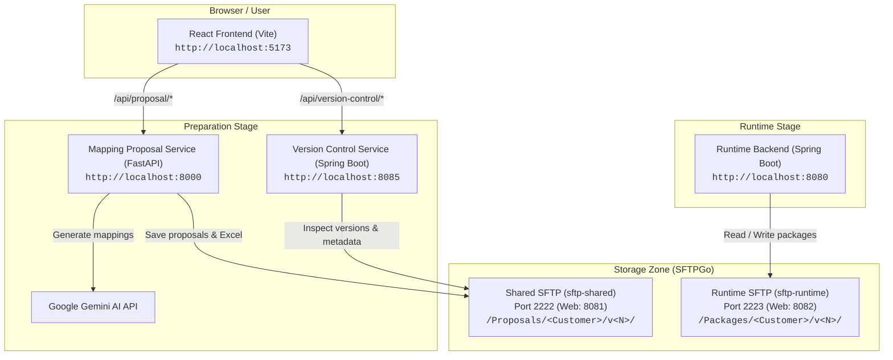

# H.Essers Mapping Platform

The **H.Essers Mapping Platform** is a distributed platform designed to automate and streamline customer-specific XML data mappings into standardized H.Essers logistics schemas. It combines an AI-driven proposal generation pipeline with version control tracking, human-in-the-loop review, and automated runtime packaging.

---

## Architecture Overview



---

## Prerequisites

Ensure the following tools are installed on your workstation:

* **Docker & Docker Compose** (for local SFTPGo servers)
* **Java 21+** (for Spring Boot backend microservices; Maven wrapper is included)
* **Python 3.12+** & `pip` (for Mapping Proposal FastAPI backend)
* **Node.js 20+** & `npm` (for React Vite frontend)

---

## Quick Start Guide

Follow these steps in separate terminal windows to launch the full environment locally.

### Step 1: Environment Variables Setup

The project uses a unified environment file located in the parent directory (`../.env`).

1. Copy the example environment file:
   ```bash
   cp .env.example ../.env
   ```
2. Verify and update `API_KEYS` in `../.env`.
3. In each new terminal session, load the environment variables:
   ```bash
   source ../.env
   ```

> [!TIP]
> All variables in `../.env` use `export`, so sourcing the file immediately propagates all configurations (`SFTP_SHARED_HOST`, `SERVER_PORT`, `GEMINI_API_KEY`, etc.) down to child processes.

---

### Step 2: Start Local SFTP Storage Servers

Launch the multi-tenant SFTPGo containers (`sftp-shared` on port `2222` and `sftp-runtime` on port `2223`):

```bash
docker compose -f Scripts/docker-compose.sftp.yml up -d
```

* Verify both containers are running:
  ```bash
  docker compose -f Scripts/docker-compose.sftp.yml ps
  ```

---

### Step 3: Start the Version Control Service

The Version Control service inspects versions, companion metadata (`metadata.json`), and proposal spreadsheets on the shared SFTP server.

```bash
cd Version_Control
source ../../.env    # if in a new terminal
./mvnw spring-boot:run
```

* Service runs on: **`http://localhost:8085`**
* Overview endpoint: `http://localhost:8085/proposals`
* File details endpoint: `http://localhost:8085/proposals/file?company=<company>&version=<version>`
* Parsed file data endpoint: `http://localhost:8085/proposals/filedata?company=<company>&version=<version>`

---

### Step 4: Start the Mapping Proposal Service

The Mapping Proposal service ingests customer XML files, communicates with Gemini to generate schema mappings in Excel format, and monitors incoming uploads.

1. Navigate to the service folder:
   ```bash
   cd Mapping_Proposal
   source ../../.env    # if in a new terminal
   ```
2. Set up the Python virtual environment:
   ```bash
   python3 -m venv .venv
   source .venv/bin/activate
   pip install -r requirements.txt
   ```
3. *(Optional)* Seed sample customer proposals onto the SFTP server:
   ```bash
   python -m scripts.dev_seed
   ```
4. Start the FastAPI server (with reload and background upload watcher):
   ```bash
   uvicorn api:app --reload --port 8000
   ```

* Service runs on: **`http://localhost:8000`**
* Interactive Swagger API Documentation: **`http://localhost:8000/docs`**

---

### Step 5: Start the React Frontend

The Frontend application provides the user interface for uploading customer files, viewing mapping proposals, version diffs, and downloading generated Excel workbooks.

```bash
cd Frontend
source ../../.env    # if in a new terminal
npm install
npm run dev
```

* Open your browser at: **`http://localhost:5173`**

The Vite development server automatically reverse-proxies `/api/proposal/*` to port `8000` and `/api/version-control/*` to port `8085`, matching Kubernetes ingress routing.

---

## Service Endpoints & Ports

| Service | Port | Description | URL / Interface | Default Credentials |
| :--- | :--- | :--- | :--- | :--- |
| **Frontend UI** | `5173` | React web application | [http://localhost:5173](http://localhost:5173) | — |
| **Mapping Proposal API** | `8000` | FastAPI mapping & upload service | [http://localhost:8000/docs](http://localhost:8000/docs) | — |
| **Version Control API** | `8085` | Spring Boot proposal history | [http://localhost:8085/proposals](http://localhost:8085/proposals) | — |
| **Shared SFTP (SFTP)** | `2222` | SFTPGo shared proposals server | `sftp://localhost:2222/Proposals` | `shareduser` / `devpassword` |
| **Shared SFTP (WebUI)**| `8081` | Web file browser for `sftp-shared` | [http://localhost:8081](http://localhost:8081) | `shareduser` / `devpassword` |
| **Runtime SFTP (SFTP)**| `2223` | SFTPGo runtime packages server | `sftp://localhost:2223/Packages` | `runtimeuser` / `devpassword` |
| **Runtime SFTP (WebUI)**| `8082` | Web file browser for `sftp-runtime`| [http://localhost:8082](http://localhost:8082) | `runtimeuser` / `devpassword` |
| **Runtime Backend** | `8080` | Spring Boot runtime engine | [http://localhost:8080/actuator/health](http://localhost:8080/actuator/health) | — |

---

## Running Tests

To verify services individually:

### Mapping Proposal (Python)
```bash
cd Mapping_Proposal
source .venv/bin/activate
pytest
```

### Version Control (Java Spring Boot)
```bash
cd Version_Control
./mvnw test
```

### Runtime Backend (Java Spring Boot)
```bash
cd Runtime
./mvnw test
```

### Frontend (Vitest & Playwright)
```bash
cd Frontend
npm test -- --run     # Run unit & component tests
npx playwright test   # Run end-to-end browser tests
```

### Infrastructure & Scripts
```bash
python3 -m unittest discover -s Scripts/tests -p "test_*.py"
node Scripts/tests/test_service_workflows.cjs
```

---

## Stopping the Platform

To stop the background SFTP containers:
```bash
docker compose -f Scripts/docker-compose.sftp.yml down
```

To stop containers and wipe uploaded test files from the local SFTP shares:
```bash
docker compose -f Scripts/docker-compose.sftp.yml down -v
```
